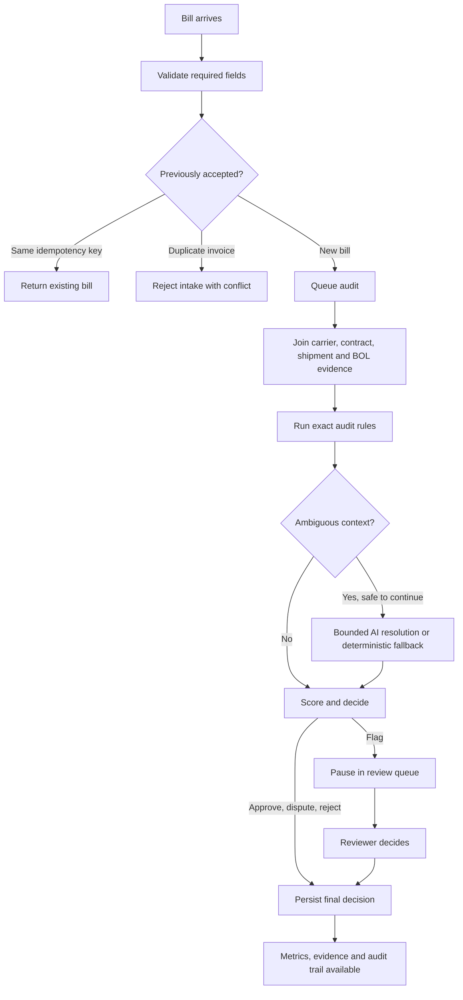
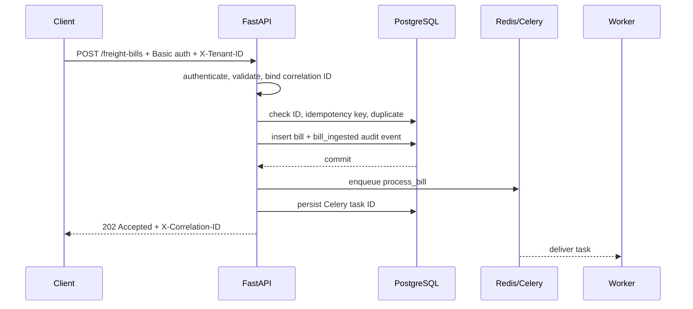
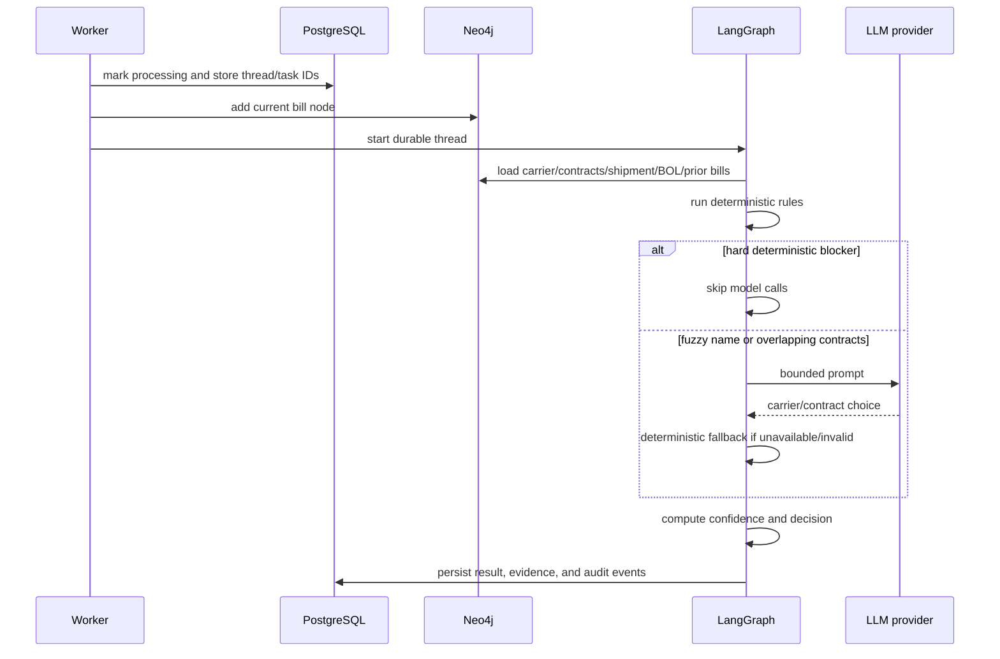
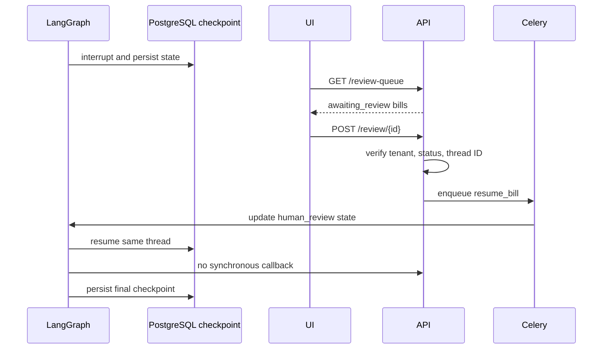

# Functional and Technical Flows

## Functional flow

### Operator journey

1. Sign in to a tenant workspace.
2. Create a bill manually, submit a JSON batch, or load the synthetic demo.
3. Monitor pending and processing bills while workers audit them.
4. Open a bill to inspect its findings, evidence, confidence, explanation, and audit timeline.
5. Work the review queue for paused cases.
6. Submit `approve`, `dispute`, or `reject` with notes.
7. Confirm the resumed bill reaches a final state.

## Technical intake flow

For bulk intake, each accepted item is committed through the same service logic and then enqueued independently. Invalid or duplicate items are reported without discarding unrelated accepted items.

## Technical agent flow

## Human-review resume flow

The worker also writes the final business result to normal PostgreSQL tables. A checkpoint alone is not considered a completed product decision.

## Demo load flow

1. `POST /admin/demo/load` removes only demo-prefixed records for the current tenant.
2. It inserts synthetic company, partner, carrier, contract, shipment, BOL, bill, and audit records.
3. Each bill stores its demo category, scenario, and expected behavior in `evidence`.
4. The API rebuilds the tenant graph once.
5. All 120 bills are queued through the same Celery path as normal bills.
6. `DELETE /admin/demo` removes only the synthetic portfolio and rebuilds the tenant graph.

## Failure flow

- Validation failures return an HTTP error before persistence.
- Duplicate/idempotent behavior is resolved before queueing.
- Connection and timeout task failures retry with backoff up to three times.
- Unhandled agent errors move the bill to `awaiting_review`, add an `agent_error` audit event, and retain the exception message for operators.
- Provider quota/rate-limit failures open a process-local circuit breaker; deterministic processing continues.
- Health endpoints isolate API, database, and graph reachability.
