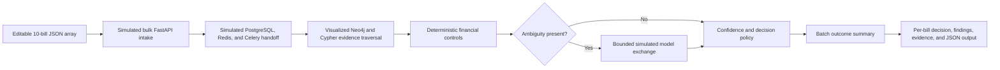

# Frontend-Only Product Demonstration

The public product demonstration is a static React experience that can be hosted without FastAPI, Celery, PostgreSQL, Redis, Neo4j, or a paid model provider. It processes a 10-bill portfolio and explains the production processing path while keeping every demonstration calculation and animation inside the visitor's browser.

Open the demonstration at `/#demo` and select **Process demo data**.

## Purpose and boundary

This mode is designed for portfolios, product walkthroughs, and architecture discussions where running the complete backend continuously is not practical.

| Demonstration behavior | Production behavior |
|---|---|
| Ten synthetic bills are loaded from a standalone JSON fixture | Submitted batches are validated and persisted by FastAPI |
| Processing runs as deterministic TypeScript in the browser | Processing runs as a durable Celery and LangGraph workflow |
| API, queue, graph, rule, model, and persistence exchanges are simulated and labelled | Services exchange real requests and persist their results |
| Graph nodes and edges are derived from local scenario fixtures | Neo4j executes tenant-scoped Cypher against projected evidence |
| Ambiguous contract selection uses a transparent local closest-rate rule | The model adapter may select only from graph-supplied contract IDs and has a deterministic fallback |
| Refreshing the page discards the run | PostgreSQL stores the decision, evidence, audit events, and checkpoints |

No secret, model key, database, or network API is required. The page explicitly identifies its simulation boundary so a viewer cannot mistake generated exchanges for live backend traffic.

## Demonstrated processing flow



The timeline processes all ten bills together and exposes aggregate approved, review, disputed, and rejected counts. A result table lets the viewer select any bill and inspect its request/response trace. The evidence graph displays the carrier, contracts, lane, shipment, BOL, and invoice relationships used by that bill. For overlapping-contract cases, the model panel shows both the restricted input contract set and the simulated structured response.

## Included scenarios

| Scenario | Bills | Control path | Expected outcome |
|---|---:|---|---|
| Clean invoice | 2 | One carrier, contract, shipment, and matching BOL | Automatic approval |
| Contract ambiguity | 2 | Two valid contracts cover the lane | Bounded contract selection, then approval |
| Weight overbilling | 2 | Billed weight exceeds connected BOL weight | Deterministic dispute |
| Duplicate invoice | 1 | Bill number links to a prior tenant bill | Immediate rejection |
| Inconsistent total | 2 | Submitted total differs from component sum | Human review |
| Unknown carrier | 1 | Carrier ID is absent from tenant master data | Dispute and master-data correction |

The JSON array remains editable and accepts up to 50 bills. Invalid JSON, missing identifying fields, duplicate IDs, and non-array input are rejected in the page. Each record's `demo_scenario` selects its synthetic reference graph. The full-stack 120-bill fixture remains the comprehensive runtime test and is documented in [Demo scenario catalogue](demo-scenarios.md).

## Run locally

```bash
cd frontend
npm ci
npm run dev
```

Open <http://localhost:5173/#demo>. No `.env` file or backend process is needed for this route.

To exercise the exact production bundle:

```bash
cd frontend
npm run build
npm run preview
```

Open <http://localhost:4173/#demo>.

## Deploy on a static host

1. Use Node.js 20 or newer in the build environment.
2. Run `npm ci` and `npm run build` inside `frontend/`.
3. Publish `frontend/dist/` as the site root.
4. Link visitors to `/#demo` or let them use the landing-page **Process demo data** action.

The hash route is intentional: static hosts can serve `index.html` without a history-API rewrite rule. The generated bundle has no runtime backend dependency for the public demonstration. Authenticated product pages still require the real `/api` service.

## Maintaining the demonstration

- The default 10-bill input portfolio lives in `frontend/demo/demo-bills.json`.
- Reference evidence, graph construction, controls, and outputs live in `frontend/src/demo/demoEngine.ts`.
- Presentation, animation, request/response panels, and the SVG evidence graph live in `frontend/src/pages/DemoPage.tsx`.
- Keep all names and identifiers synthetic. Do not copy production invoices into the browser bundle.
- When production decision rules change, update this engine and the comparison table together.
- Keep simulated network/model outputs labelled. If a future version calls a real service, add consent, error, latency, cost, and secret-handling states before removing that label.

## Possible extensions

- Export the final demonstration report as a client-generated PDF.
- Add a side-by-side comparison of original invoice fields and normalized values.
- Replay a saved sequence with pause, step, and speed controls.
- Generate scenario fixtures from a shared schema so Python and TypeScript examples cannot drift.
- Add browser tests for every batch row and snapshot the summary, decision, graph, and final JSON.
- Offer an optional live-backend toggle only when a health check succeeds, while retaining this static fallback.
