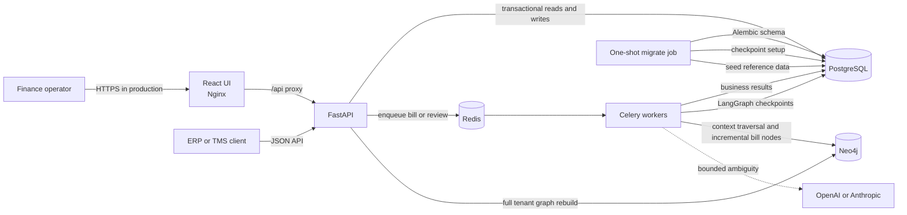
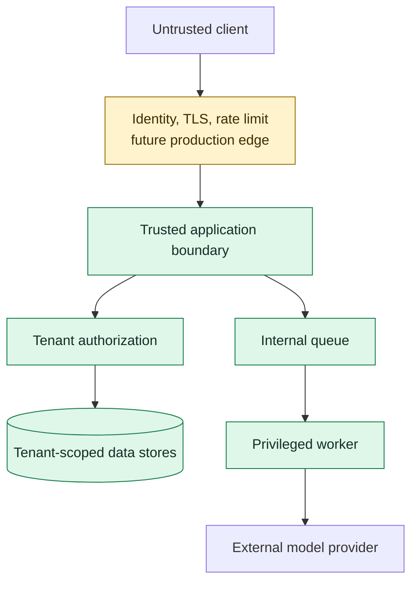

# High-Level Design

## Container architecture

## Responsibilities

| Component | Owns | Does not own |
|---|---|---|
| React + Nginx | Operator interaction and `/api` proxy | Financial decisions or authorization policy |
| FastAPI | Authentication, tenant resolution, validation, persistence, query APIs, enqueueing | Long-running agent execution |
| Celery | New agent runs and review resumes | Durable business truth |
| Redis | Task delivery and short-lived results | Final workflow state |
| PostgreSQL | Transactional records, evidence, audit entries, workflow status, checkpoints | Relationship-optimized traversal |
| Neo4j | Tenant-scoped relationship traversal and graph anomaly queries | Authoritative bill status |
| LangGraph | Ordered agent state machine and interrupts | Schema migrations or queue delivery |
| LLM provider | Fuzzy carrier matching, bounded contract choice, explanation wording | Arithmetic, date boundaries, duplicates, policy thresholds |
| Alembic | Application-schema history | LangGraph-owned checkpoint schema |

## Deployment topology

Docker Compose provides a complete local topology. In production, the same boundaries should be deployed as independently managed services:

- stateless API replicas behind a TLS load balancer;
- independently autoscaled Celery worker pools;
- managed PostgreSQL with backups and high availability;
- managed Redis with authentication and eviction policy review;
- persistent Neo4j cluster or managed graph service;
- a release job for Alembic and checkpoint initialization;
- centralized logs, metrics, traces, alerts, and secret management.

## Trust boundaries

The production edge shown above is a required improvement. Today, HTTP Basic bootstrap credentials and permissive CORS make the application appropriate for controlled local/demo use only.

## Availability and consistency choices

- PostgreSQL commits a bill before it is enqueued, preventing workers from reading an uncommitted record.
- Queue submission is currently not protected by a transactional outbox. A crash after commit but before enqueue can leave a pending record; an outbox is a priority improvement.
- Celery uses late acknowledgement, worker-loss rejection, bounded automatic retry for connection/timeouts, and prefetch `1`.
- Agent checkpoints allow review state to outlive an API or worker process.
- Neo4j is rebuilt by API/admin flows and updated incrementally by workers to avoid destructive rebuild races.
