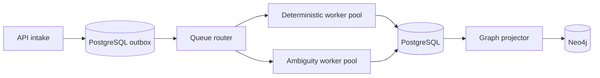

# Improvement and Scaling Roadmap

## Current maturity

The project has durable processes, migrations, queue workers, checkpoints, tenant-scoped services, graph traversal, structured logs, a full UI, and real PostgreSQL integration coverage. It is production-shaped, but its local bootstrap identity, permissive CORS, missing outbox, limited pagination, and operational gaps mean it should not be exposed directly to the public internet.

## Priority 0: security and correctness

1. Replace HTTP Basic bootstrap credentials with OIDC/OAuth2, MFA, short-lived tokens, and service identities.
2. Add role-based permissions for ingestion, review, admin/demo operations, and reference-data changes.
3. Persist immutable reviewer identity and authorization context in audit events.
4. Restrict CORS, terminate TLS, rate-limit endpoints, protect secrets, and add security headers.
5. Validate dates, currency, tax regime, bill-number normalization, and tenant-safe global identifiers.
6. Add PostgreSQL row-level security as defense in depth.
7. Add a transactional outbox so committed work is never lost before queue publication.
8. Add idempotent worker leases/version checks to tolerate duplicate delivery safely.

## Priority 1: operational reliability

1. Cursor-pagination and server-side filtering for bills, reviews, and audit events.
2. Dead-letter handling, retry dashboards, manual replay, and queue-age alerts.
3. OpenTelemetry traces across API, Celery, PostgreSQL, Neo4j, and model calls.
4. SLOs for intake latency, processing duration, review age, error rate, and graph freshness.
5. Neo4j projection watermark, reconciliation, and tenant-scoped repair jobs.
6. Backup/restore drills for business and checkpoint tables.
7. Load tests for API intake, worker throughput, checkpoint pool saturation, and graph queries.
8. Separate readiness and liveness probes; ensure dependency failures do not cause restart storms.

## Priority 2: audit quality and product depth

1. Versioned contract/rate-card management with effective dating and approval workflow.
2. Document upload and OCR extraction with source-page citations.
3. Currency and tax engines rather than total-only GST evidence.
4. Configurable policy packs per tenant, carrier, lane, and invoice value.
5. Label reviewer outcomes and calibrate decision thresholds against false-approval cost.
6. Introduce similarity/alias models for carrier normalization to reduce LLM cost.
7. Cost, token, latency, fallback, and quality dashboards for model operations.
8. Extend the workflow registry for accessorial, customs, and vendor-invoice audits only after isolating shared versus workflow-specific controls.

## Scaling strategy

Recommended evolution:

- Scale API and workers independently.
- Route deterministic and model-assisted jobs to separate queues so provider latency cannot block clean bills.
- Batch reference-data graph projection instead of rebuilding on request paths.
- Partition or archive high-volume audit logs.
- Split checkpoint connections from application query pools.
- Use tenant/value-based fairness so one large import cannot starve interactive work.
- Move very large CSV/EDI imports to object storage plus asynchronous import jobs.

## When to simplify instead

More infrastructure is not automatically better. For smaller deployments, PostgreSQL-only relationship tables, a single worker, and rules-only processing may be safer and cheaper. Remove Neo4j when relationship queries remain shallow; disable external models when aliases and policy rules cover the data. Complexity should be justified by measured latency, volume, quality, or isolation needs.

## Measuring improvement

Track at least:

- precision/recall for overcharge detection;
- false auto-approval rate;
- percentage auto-approved, disputed, and sent to review;
- reviewer overturn rate by finding code;
- average review age and processing time;
- value recovered or prevented, with a documented calculation;
- duplicate delivery/retry rate;
- model call rate, fallback rate, latency, and cost;
- graph projection lag and reconciliation failures;
- tenant-isolation and authorization test coverage.

An improvement is complete only when it changes a measured outcome without weakening auditability or tenant isolation.
