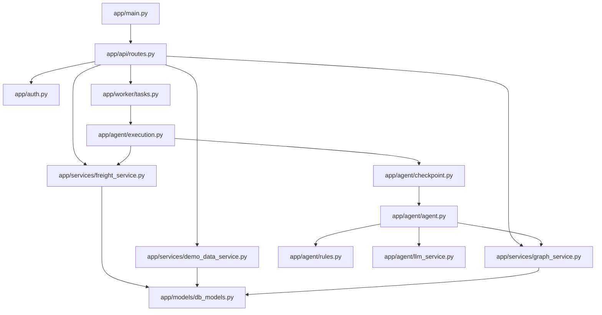
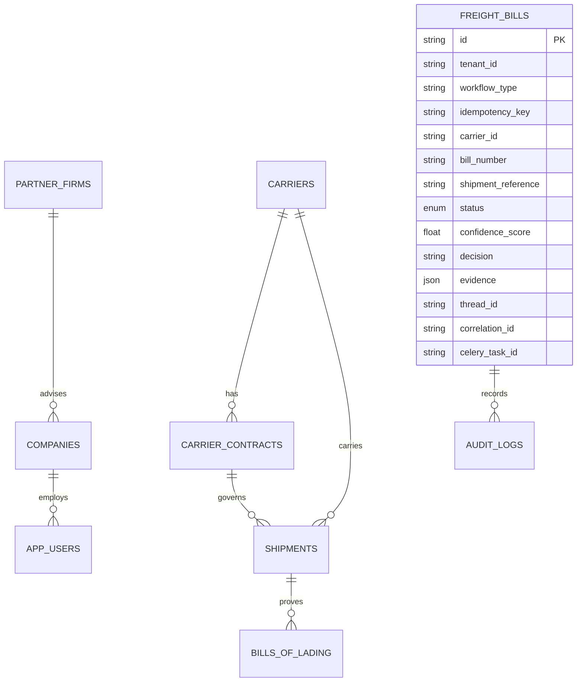
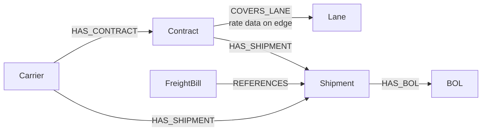
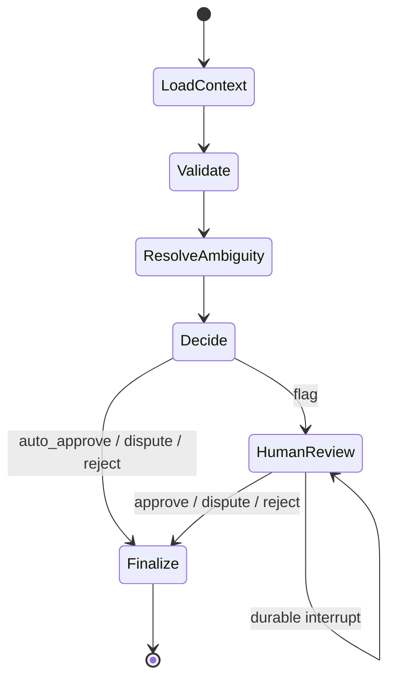

# Low-Level Design

## Module structure

## Relational data model

Every business query is scoped by `tenant_id`. Several external identifiers are globally primary-keyed today, so callers should still generate globally unique IDs even though lookup behavior is tenant scoped.

## Graph projection

All graph nodes contain `tenant_id`; Neo4j uniqueness constraints use `(tenant_id, id)`. Rate-row data is stored on `COVERS_LANE`, allowing the agent to retrieve the matching row with the contract.

## Agent state machine

The state includes the raw bill, tenant, resolved evidence, findings, confidence, decision, reviewer input, and accumulated audit events. `findings` and `audit` use LangGraph reducers to append node outputs.

## Deterministic validation sequence

1. Duplicate number check.
2. Known-carrier check.
3. Internal total check.
4. Graph-native anomaly findings.
5. Weight versus all connected BOLs, adjusted by prior billed weight.
6. Skip LLM work if a duplicate, unknown carrier, weight mismatch, or inconsistent total is already decisive.
7. Select a single contract or resolve overlap.
8. Re-run contract-dependent date, minimum-weight, rate, surcharge, base-charge, and UOM checks against the chosen contract.
9. De-duplicate findings by code, with the later contract-specific result winning.
10. Compute confidence and route the workflow.

## Persistence ownership

Alembic owns application tables through migrations `0000` to `0004`. `AsyncPostgresSaver.setup()` owns the LangGraph checkpoint tables. Alembic excludes those tables from autogeneration so the two migration systems do not fight over ownership.

## Concurrency invariants

- The API never runs the agent in a request process.
- Each Celery prefork child reuses one asyncio event loop so async pools remain loop-bound.
- Each new processing attempt receives a unique `thread_id`; review resumes use the exact persisted thread.
- Shared Neo4j workers do not perform a full graph rebuild.
- A task stores its correlation ID and Celery task ID on the freight bill for reconstruction.
